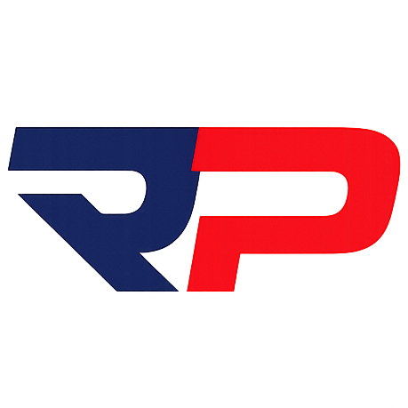

  

## 😼 Sobre mim

De fato, sou o Matheus Leone, dono desse perfil.

- 🦫 **Co-fundador da [Capivara](https://capivaratechs.com/)**, fábrica de software e estúdio de design: sites, sistemas e apps desenhados e construídos pelo mesmo time
- 🚚 **Líder técnico no Grupo Rodopenha**, onde cuido do time e dos sistemas que mantêm a operação de transporte rodando
- 🌱 Nas horas vagas, cuido de um jardim virtual onde cada planta é única
- ⚙️ Gosto de produto bem acabado: interface caprichada por fora, banco bem modelado por dentro

## 💼 Onde estou

<table>
  <tr>
    <td width="50%" valign="top" align="center">
      
       
      <b>Capivara</b> · co-fundador
       
      Design que vende. Software que funciona.
    </td>
    <td width="50%" valign="top" align="center">
      
       
      <b>Grupo Rodopenha</b> · líder técnico
       
      Tecnologia para a operação de transporte
    </td>
  </tr>
</table>

## 🛠️ Stack

  
   
  

## 🌱 Projeto pessoal: Brotaria

Um jardim virtual em que **cada planta tem um DNA próprio**: a arte é gerada por IA e a planta cresce mantendo a mesma identidade visual, ganhando detalhes a cada estágio em vez de virar outra coisa.

`Next.js` · `TypeScript` · `Supabase` · `IA generativa` · `Capacitor (Android)`

**[brotaria.online](https://brotaria.online/)**

## 🤝 Parcerias

<table>
  <tr>
    <td width="50%" valign="top" align="center">
      
       
      <b><a href="https://wizardlegacy.com.br">Wizard Legacy</a></b>
       
      Servidor de Open Tibia com tema bruxo: o legado espera por você
    </td>
    <td width="50%" valign="top" align="center">
      <!-- TODO: trocar pelo logo e pelo link oficial da banda -->
      <h1>🎸</h1>
      <b>Banda Karmaleões</b>
       
      Parceiro de tecnologia da banda
    </td>
  </tr>
</table>

## 📊 Estatísticas

  
  

  
  

  

 

<picture>
  <source media="(prefers-color-scheme: dark)" srcset="https://raw.githubusercontent.com/matheu5leone/matheu5leone/output/github-snake-dark.svg" />
  
</picture>

## 📫 Contato

  
  
  <!-- TODO: LinkedIn
  
  -->

BoOoOoh👻

